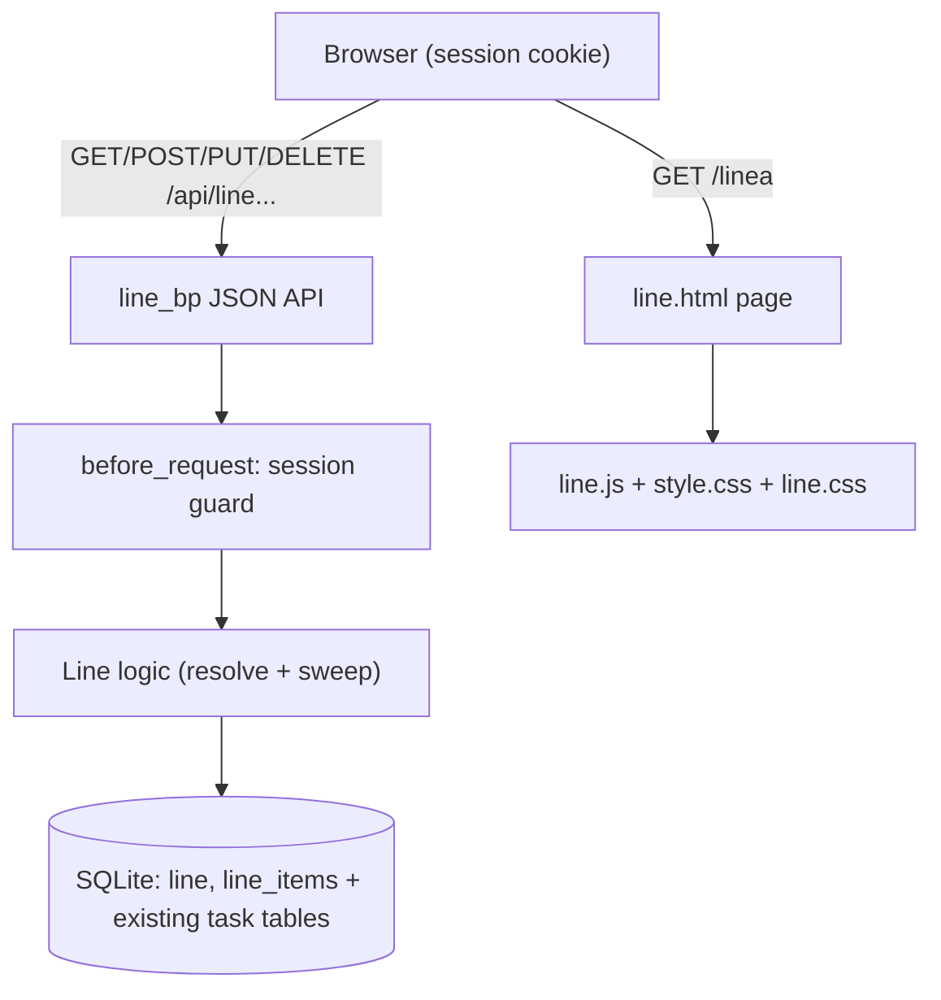

# Design: Line of Task (TaskManager)

## Overview

"Line of task" (Línea del día) is a new section of TaskManager where a user assembles the ordered list of activities for their day by **picking tasks that already exist** across the three per-module task tables (`tasks` → academic, `work_tasks` → work, `personal_tasks` → personal). The section never creates, edits, or deletes the underlying tasks: it only *references* and *orders* them.

The feature follows the architecture already established by the other modules:

- A self-contained Flask **blueprint** registered with a single `app.register_blueprint(...)` call, exposing one HTML page plus a JSON API under `/api/...`.
- **Session/cookie authentication** via the same `before_request` guard the task and calendar modules use (pages redirect to `/login`, API returns `401`). It does **not** use the external `/api/v1` Bearer API.
- **SQLite** storage through the shared `database.get_connection()`, with an `init_db()` hook invoked from `app.py` in the same place as the other modules.
- The existing **sober, minimalist** visual language (shared `style.css`, Fraunces/Inter fonts, the shared nav bar from `nav.py`).

### Key design decisions

| Decision | Rationale |
| --- | --- |
| A task is referenced by the pair `(module, task_id)`, never by `task_id` alone. | Task ids are only unique *within* one module's table. The same numeric id can exist in `tasks`, `work_tasks`, and `personal_tasks`. The composite key is the only safe reference. |
| "Nature" is derived from the module string, not stored on the task. | Honors FR-01 and NFR-03: the existing task tables are not altered. The module column already lives on the *line item*, which is enough to label each point. |
| Line items live in **new** tables (`line`, `line_items`), isolated from task tables. | No schema change to `tasks`/`work_tasks`/`personal_tasks` (NFR-03). The new tables carry `user_id` for per-user isolation, matching the multi-user pattern of the rest of the app. |
| Dangling references are **resolved on read** (and swept lazily), not enforced by a cross-table foreign key. | SQLite cannot declare a foreign key whose target table depends on a runtime `module` value. FR-11 ("when a referenced task is deleted, its line item is removed") is satisfied by filtering/removing line items whose target task no longer exists. |
| One line per user ("the user's line of the day"). | Matches the requirement wording ("One line per user"). No multi-line management UI is needed, keeping the design minimal (NFR-01). |

## Architecture

The feature is a new module `line_module.py` exposing a blueprint `line_bp`, registered in `app.py` next to the existing blueprints. It reuses `database.get_connection()`, `nav.NAV_LINKS`, and the session guard pattern. A new nav link points to the line page.



### Request flow for building and viewing the line

1. The page `GET /linea` renders `line.html` with the shared nav and the module's JS config.
2. `line.js` calls `GET /api/line` to load the current ordered line (with each item's resolved task + subtasks).
3. To add tasks, the page offers a picker populated by `GET /api/line/available` (existing tasks grouped by nature). The user selects tasks; `line.js` calls `POST /api/line/items` for each.
4. Reordering calls `PUT /api/line/order` with the new sequence of item ids; removal calls `DELETE /api/line/items/<id>`.
5. On every read, line items whose target task no longer exists are filtered out of the response and deleted from `line_items` (lazy sweep), satisfying FR-11.

### Integration points (changes to existing files)

- **`app.py`**: `from line_module import line_bp`, `app.register_blueprint(line_bp)`, and call `line_bp.init_db()` inside `__main__` after the task modules' `init_db()` (the line tables reference `users` and read the task tables).
- **`nav.py`**: add `{"href": "/linea", "label": "Línea del día"}` to `NAV_LINKS` so the link appears in every module's nav bar.

No other existing file changes. The task modules, calendar, auth, and external `/api/v1` API are untouched (NFR-02, NFR-03).

## Components and Interfaces

### `line_module.py`

A module mirroring the structure of `calendar_module.py`: a blueprint, a `before_request` session guard, an `init_db()` creating the new tables, a page route, and the JSON API.

```python
line_bp = Blueprint("line", __name__)

MODULE_LABELS = {"academic": "Académico", "work": "Trabajo", "personal": "Personal"}
VALID_MODULES = set(MODULE_LABELS)   # module tables map, mirrors api_module.TASK_MODULES

TASK_MODULES = {
    "academic": ("tasks", "subtasks"),
    "work": ("work_tasks", "work_subtasks"),
    "personal": ("personal_tasks", "personal_subtasks"),
}
```

#### Session guard (identical pattern to calendar/task modules)

```python
@line_bp.before_request
def require_login():
    if session.get("user_id") is not None:
        return None
    if request.path.startswith("/api/"):
        return jsonify({"error": "No autorizado"}), 401
    return redirect(url_for("auth.login", next=request.path))
```

#### HTTP interface

| Method & path | Purpose | Request body | Success response |
| --- | --- | --- | --- |
| `GET /linea` | Render the line page. | — | `line.html` |
| `GET /api/line` | Return the current user's ordered line with each item's resolved task + subtasks. Dangling items are swept first. | — | `200` ordered list of line items (see Data Models) |
| `GET /api/line/available` | Return the user's existing tasks grouped by nature, for the picker. Optional `?module=academic\|work\|personal` to fetch one group. | — | `200` object keyed by module, each a task list |
| `POST /api/line/items` | Add one existing task to the line at the end. | `{"module": "...", "task_id": N}` | `201` the created line item (resolved) |
| `PUT /api/line/order` | Set the order of the whole line. | `{"item_ids": [id, id, ...]}` | `200` the reordered line |
| `DELETE /api/line/items/<int:item_id>` | Remove one item from the line. | — | `200 {"ok": true}` |

Validation and error contract (consistent with the other modules):

- Missing/invalid `module` → `400 {"error": ...}`.
- `module`/`task_id` referencing a task that does not exist or is not owned by the session user → `404 {"error": ...}` (never leaks another user's tasks).
- Adding a `(module, task_id)` already present in the line → `409 {"error": ...}` (a task appears at most once in the line).
- `PUT /api/line/order` with an `item_ids` set that does not exactly match the user's current item ids → `400 {"error": ...}` (no partial/foreign ids).
- Operating on an `item_id` not owned by the session user → `404`.

#### Core internal helpers

```python
def get_or_create_line(conn, user_id) -> int:
    """Return the user's line id, creating the single line row if absent."""

def task_exists(conn, module, task_id, user_id) -> bool:
    """True if (module, task_id) is a task owned by user_id in that module's table."""

def resolve_line(conn, user_id) -> list[dict]:
    """Return ordered line items with their resolved task + subtasks.
    Sweeps (deletes) items whose target task no longer exists before returning."""

def sweep_dangling(conn, line_id) -> int:
    """Delete line_items whose (module, task_id) target no longer exists.
    Returns count removed. Called by resolve_line (FR-11)."""
```

### Frontend: `templates/line.html`, `static/line.js`, `static/line.css`

- `line.html` reuses the shared `<header>` with nav from `nav_links`, loads `style.css` and a small `line.css`, and exposes `window.APP_CONFIG = { apiBase: "/api/line" }` the way `tasks.html` does for `app.js`.
- The page has two regions: a **timeline** (the ordered line, vertical) and a **picker** (available tasks grouped by nature) used to add items.
- The timeline renders each item as a point; FR-08. Each point shows the task title and a nature label derived from `module`. A disclosure control toggles the subtask subtree; FR-09/FR-10. Subtasks are **collapsed by default** (`line.js` renders them hidden until the user expands).
- Reordering uses simple up/down controls (minimalist, no drag library needed) that call `PUT /api/line/order`.
- Styling stays within the existing palette and typography; no new colors (NFR-01).

## Data Models

Two new tables, both carrying `user_id` for per-user isolation (consistent with the rest of the app). Created by `line_bp.init_db()` with `CREATE TABLE IF NOT EXISTS`.

```sql
CREATE TABLE IF NOT EXISTS line (
    id         INTEGER PRIMARY KEY AUTOINCREMENT,
    user_id    INTEGER NOT NULL UNIQUE,          -- one line per user
    created_at TEXT DEFAULT (datetime('now')),
    FOREIGN KEY (user_id) REFERENCES users (id) ON DELETE CASCADE
);

CREATE TABLE IF NOT EXISTS line_items (
    id        INTEGER PRIMARY KEY AUTOINCREMENT,
    line_id   INTEGER NOT NULL,
    module    TEXT    NOT NULL,                   -- 'academic' | 'work' | 'personal'
    task_id   INTEGER NOT NULL,                   -- id within that module's table
    position  INTEGER NOT NULL,                   -- order within the line (0-based)
    created_at TEXT DEFAULT (datetime('now')),
    FOREIGN KEY (line_id) REFERENCES line (id) ON DELETE CASCADE,
    UNIQUE (line_id, module, task_id)             -- a task appears at most once
);
```

Notes:

- There is intentionally **no** foreign key from `line_items` to the task tables: the target table is chosen at runtime by `module`, which SQLite cannot express as a declarative FK. Referential integrity for FR-11 is enforced in application code (`sweep_dangling`/`resolve_line`).
- `position` is normalized to a contiguous `0..n-1` sequence after every add/remove/reorder so the ordering is total and gap-free.
- `module` is validated against `VALID_MODULES` on write; it also drives the derived nature label (FR-01).

### Serialized line item (API response shape)

`GET /api/line` returns a JSON array ordered by `position ASC`. Each element:

```json
{
  "item_id": 12,
  "module": "work",
  "nature": "Trabajo",
  "position": 0,
  "task": {
    "id": 7,
    "title": "...",
    "description": null,
    "due_date": null,
    "complexity": 2,
    "subject": "...",
    "created_at": "...",
    "subtasks": [
      { "id": 3, "title": "...", "completed": false }
    ]
  }
}
```

`nature` is derived from `module` via `MODULE_LABELS`. `subtasks` is always present (empty list when the task has none), ordered by `id ASC`, mirroring the external API's serialization conventions.

## Correctness Properties

*A property is a characteristic or behavior that should hold true across all valid executions of a system — essentially, a formal statement about what the system should do. Properties serve as the bridge between human-readable specifications and machine-verifiable correctness guarantees.*

The pure-logic core of this feature (nature derivation, per-user/per-module grouping, add/remove membership with uniqueness, position normalization, and the dangling-reference sweep) is well suited to property-based testing: each has an explicit "for all" statement over a large input space, and the codebase already uses Hypothesis for exactly this kind of per-module/per-user task reasoning. Visual/layout concerns (FR-08) and the subtask expand/collapse interaction (FR-09, FR-10) are not universal properties and are covered by example and integration tests in the Testing Strategy.

The following properties were consolidated during reflection: the "task must already exist" rule (FR-04) and the uniqueness rule are folded into the add/remove membership property; the "positions stay contiguous after add/remove" rule is folded into the ordering property, since a single normalization invariant covers every mutation.

### Property 1: Nature is derived from module

*For any* line item whose `module` is one of `academic`, `work`, or `personal`, the nature label returned for that item equals the fixed label mapped from its `module`, and no field stored on the underlying task influences it.

**Validates: Requirements 1.1**

### Property 2: Available tasks are grouped by nature with owner/module isolation

*For any* set of tasks distributed across the three modules and owned by one or more users, the grouped "available tasks" result for a given user contains exactly that user's tasks, and every returned task appears only under the group matching its module of origin (never under another module, never another user's task).

**Validates: Requirements 1.2**

### Property 3: Add/remove membership and uniqueness

*For any* line and *for any* existing task `(module, task_id)` owned by the user and not already in the line, adding it increases the line's item set by exactly that reference, and subsequently removing it restores the original item set (add then remove is an identity on membership); adding a `(module, task_id)` that is not an existing owned task leaves the line unchanged, and adding a `(module, task_id)` already present leaves the line unchanged (each task appears at most once).

**Validates: Requirements 1.4, 1.6**

### Property 4: A line may mix tasks of different natures

*For any* selection of existing owned tasks drawn from two or more modules, adding all of them produces a line whose set of item modules equals the set of modules in the selection (no module is excluded or restricted).

**Validates: Requirements 1.5**

### Property 5: Ordering is an exact permutation with contiguous positions

*For any* line and *for any* permutation of its current item ids submitted as the new order, the resulting line's item sequence equals that permutation; and after any add, remove, or reorder the item positions always form a gap-free contiguous sequence `0..n-1` with no duplicates.

**Validates: Requirements 1.7**

### Property 6: Deleting a referenced task removes its line item

*For any* line referencing existing tasks, after an arbitrary subset of those tasks is deleted from their module tables, resolving the line yields no item whose `(module, task_id)` points at a non-existent task, the items for the deleted tasks are gone, and every item whose target still exists is preserved unchanged.

**Validates: Requirements 1.11**

### Property 7: Resolved items always include their subtask subtree

*For any* line item, the resolved representation includes the item's underlying task together with a `subtasks` list that contains exactly that task's subtasks, ordered by `id` ascending, with the list present (possibly empty) in every case.

**Validates: Requirements 1.9**

## Error Handling

Error handling follows the conventions already used by the task and calendar modules (JSON `{"error": ...}` bodies with appropriate status codes for the API; redirects for pages).

| Condition | Response |
| --- | --- |
| No session, request to `/api/line*` | `401 {"error": "No autorizado"}` (session guard). |
| No session, request to `GET /linea` | Redirect to `/login?next=/linea`. |
| Missing or non-`academic/work/personal` `module` on add | `400 {"error": ...}`; line unchanged. |
| `(module, task_id)` is not an existing task owned by the session user | `404 {"error": ...}`; line unchanged (also prevents leaking other users' tasks). |
| Adding a `(module, task_id)` already in the line | `409 {"error": ...}`; line unchanged (uniqueness). |
| `PUT /api/line/order` with `item_ids` that don't exactly match the user's current item ids (missing, extra, foreign, or duplicate ids) | `400 {"error": ...}`; order unchanged. |
| `DELETE`/reorder targeting an `item_id` not owned by the session user | `404 {"error": ...}`. |
| A referenced task was deleted since it was added | Not an error: the dangling item is swept on the next read (FR-11), and the response simply omits it. |

Database writes that span multiple statements (adding an item then normalizing positions; reordering) run inside a single transaction and `rollback` on any exception, so a failure never leaves positions in an inconsistent (non-contiguous) state — mirroring the atomic-rotation pattern in `auth.generate_api_token`.

## Testing Strategy

The project already uses **pytest + Hypothesis** (see `pytest.ini`, `tests/conftest.py`, `tests/strategies.py`). New tests reuse the existing `temp_db`, `connection`, `app`, and `client` fixtures and the generators in `tests/strategies.py` (which already produce tasks and subtasks across the three modules with nullable optional fields and tie-prone timestamps).

### Dual approach

- **Property tests** verify the universal properties above across many generated inputs.
- **Unit / example tests** cover specific scenarios, edge cases, and error conditions.
- **Integration / smoke tests** cover auth wiring and the no-regression guarantee.

### Property-based tests (library: Hypothesis)

- One property-based test per correctness property (Properties 1–7). The feature's logic is not reimplemented in the tests; properties are checked against the module's own functions/endpoints.
- Each property test runs a **minimum of 100 iterations** (`@settings(max_examples=100, deadline=None, suppress_health_check=[HealthCheck.function_scoped_fixture])`, matching the existing property tests).
- Each test is tagged with a comment referencing its design property, in the format:
  `# Feature: LineTask, Property {number}: {property_text}`
- Reuse `tests/strategies.py` for tasks/subtasks across modules and users; add a small helper to materialize a line and its items in the temp DB.

Mapping (one test each):

| Property | Focus |
| --- | --- |
| 1 | Nature derivation is a total function of `module`. |
| 2 | Grouping isolation by owner and module. |
| 3 | Add/remove membership identity + rejection of non-existent and duplicate adds. |
| 4 | Mixed-module lines preserve all selected modules. |
| 5 | Reorder equals submitted permutation; positions stay `0..n-1`. |
| 6 | Deleting referenced tasks sweeps exactly their items (FR-11). |
| 7 | Resolved items include their subtasks, ordered by `id`. |

### Example / unit tests

- Error contract: invalid `module` (`400`), non-existent/foreign `(module, task_id)` (`404`), duplicate add (`409`), malformed `PUT /api/line/order` payload (`400`).
- FR-09 / FR-10 UI data + interaction: an item with subtasks renders a disclosure control, subtasks are **hidden on initial render** (collapsed by default), and toggling reveals then hides them.
- FR-08: the timeline container renders one point per line item (DOM/smoke check).

### Integration / regression tests

- **Auth wiring (NFR-02):** every `/api/line*` endpoint returns `401` without a session; `GET /linea` without a session redirects to `/login`.
- **No regression (NFR-03):** after `line_bp.init_db()`, `PRAGMA table_info` of `tasks`, `work_tasks`, and `personal_tasks` is unchanged, and the existing task endpoints still behave as before.

### Why PBT is scoped the way it is

PBT is applied to the pure, input-sensitive logic (derivation, grouping, membership, ordering, sweep, serialization) where 100+ generated inputs find edge cases example tests would miss. It is deliberately **not** applied to layout/visual rendering (FR-08), the expand/collapse interaction (FR-09/FR-10 behavior), or auth/schema wiring (NFR-02/NFR-03), which have little meaningful input variation and are better served by example, DOM/smoke, and integration tests.
